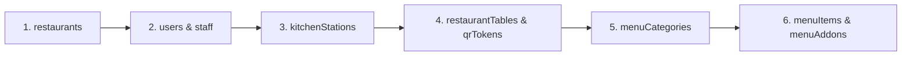

# RESTO OS - Comprehensive Firebase Manual Import Guide

**Scope:** Step-by-step console guide, field reference mapping, secure value generation, and document conventions for Cloud Firestore  

---

## 1. Firestore Console Overview

Cloud Firestore is a NoSQL document database organized into **collections** and **documents**.
- **Collection:** A group of documents (e.g. `restaurants`, `menuItems`, `orders`).
- **Document:** A JSON-like record containing fields, values, maps, and subcollections.
- **Document ID:** The unique primary key identifier for that document.

---

## 2. Mandatory Data Types in Firestore Console

When adding fields manually in the Firebase Console, choose the exact data type specified below:

| Field Name Pattern | Firestore Type | Example Value |
|---|---|---|
| `*Id`, `*Number`, `name`, `status`, `phone`, `email` | **string** | `"rest-001-main"`, `"T-01"`, `"ACTIVE"` |
| `basePrice`, `totalAmount`, `unitPrice`, `cgstAmount`, `seatingCapacity` | **number** | `340`, `850.50`, `4` |
| `isVeg`, `isAvailable`, `isActive`, `isSpicy`, `isPermanent` | **boolean** | `true` or `false` |
| `createdAt`, `updatedAt`, `openedAt`, `paidAt` | **timestamp** | Set to current date/time |
| `settings`, `variants`, `addons`, `items` | **map** or **array** | `settings` is a Map; `items` is an Array of Maps |

---

## 3. Order of Importing Collections

To ensure foreign keys and references exist before child documents are created, import collections in the following sequence:

1. **`restaurants`**: Create root restaurant document with ID `rest-001-main`.
2. **`users`**: Create user documents whose Document ID matches the Firebase Auth UID.
3. **`staff`**: Link `userId` to the corresponding `users` document ID.
4. **`kitchenStations`**: Create stations (`sta-curry`, `sta-tandoor`, etc.) before menu items.
5. **`restaurantTables`**: Create floor tables (`tbl-01`, `tbl-02`, etc.).
6. **`menuCategories`**: Create categories (`cat-starters`, `cat-mains`, etc.).
7. **`menuItems`**: Add dishes linking `categoryId` and `kitchenStationId`.
8. **`menuAddons`**: Add optional modifiers.

---

## 4. Collections Populated Dynamically at Runtime

Do **NOT** manually populate transaction records; these are created automatically during live operations:
- `tableSessions`: Created when customers scan permanent table QR codes.
- `orders` & `orderItems`: Created when diners submit their bag.
- `kitchenTickets`: Created when orders are routed to kitchen stations.
- `waiterCalls`: Created when customers click "Call Waiter" or "Bill Request".
- `invoices` & `payments`: Created when cash counter settles table bills.
- `auditLogs`: Created when staff log in, change roles, or perform administrative tasks.
