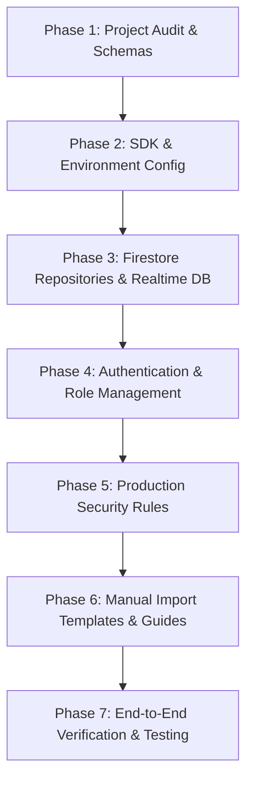

# RESTO OS - Firebase Migration Plan (Spark ₹0 Tier)

**Document Version:** 1.0.0  
**Target Architecture:** Firebase (Auth, Firestore, Realtime Database, FCM)  
**Budget Policy:** Strictly ₹0 / month (Firebase Spark Compatible)  

---

## 1. Migration Strategy Overview

This migration plan defines the phased transition of RESTO OS from Supabase/localStorage to **Firebase** without breaking existing working features, user roles, or UI components.

### Core Principles
1. **Zero Downtime & Zero Regression:** All 134 existing automated tests must continue passing.
2. **Preserve Supabase Artifacts:** Never delete `supabase/migrations/`, `supabase/seed.sql`, or existing credentials.
3. **Dual-Backend Compatibility Adapter:** The `databaseAdapter.ts` interface will act as the unified data broker, delegating to Firestore when configured, with seamless fallback for offline or unconfigured environments.
4. **Strict ₹0 Budget Compliance:** Absolutely no paid APIs, no Blaze upgrade, and no dependence on Firebase Cloud Functions.
5. **Manual Console Import Friendly:** Schemas and document structures are designed for straightforward manual import via the Firebase Console without requiring paid third-party tools.

---

## 2. Phased Rollout Roadmap



### Phase 1: Project Audit & Schemas (Completed)
- Inspect all files, services, and stores.
- Create `FIREBASE_INTEGRATION_AUDIT.md`.
- Create `FIREBASE_MIGRATION_PLAN.md`.
- Create `FIREBASE_DATABASE_SCHEMA.md`.

### Phase 2: Firebase SDK Integration & Environment Setup
- Install the official `firebase` modular JavaScript SDK (`npm i firebase`).
- Build `src/lib/firebase.ts` with singleton initialization, connection testing, and health checks.
- Safely populate `.env` with the user's provided project credentials (`resto-os-3bf6c`).
- Update `.env.example` with standard Firebase environment keys.
- Create `FIREBASE_ENVIRONMENT_GUIDE.md`.

### Phase 3: Firestore Repositories & Realtime Database Integration
- Define Firestore TypeScript interfaces in `src/types/firestore.ts`.
- Implement type-safe Firestore repositories in `src/services/firebase/`:
  - `restaurantRepository.ts`: Restaurant profile and operational settings.
  - `tableRepository.ts`: Tables, QR token generation, and verification.
  - `menuRepository.ts`: Categories, items, variants, and add-ons.
  - `orderRepository.ts`: Atomic order placement with server-calculated totals.
  - `kitchenRepository.ts`: KDS tickets, station routing, status transitions.
  - `waiterCallRepository.ts`: Customer assistance requests, priority, acceptance.
  - `billingRepository.ts`: Invoices, payments, daily collection summaries.
  - `customerRepository.ts`: Customer recognition and loyalty stamp tracking.
  - `auditLogRepository.ts`: Immutable security audit event recording.
- Implement Realtime Database presence service in `src/services/firebase/rtdbPresenceService.ts`:
  - Staff online/offline presence tracking (`/presence/{restaurantId}/{userId}`).
  - Active waiter and kitchen device pinging (`/deviceStatus/{restaurantId}/{deviceId}`).
  - Ephemeral operational event bus (`/liveEvents/{restaurantId}/{eventId}`).
- Implement Web Push / FCM integration:
  - Create `public/firebase-messaging-sw.js` for background push notifications.
  - Create `src/services/firebase/fcmService.ts` for foreground listener and token handling.
- Create `FIREBASE_REALTIME_ARCHITECTURE.md`.

### Phase 4: Authentication & Role Management (Spark-Compatible)
- Support all 6 user roles:
  1. `Master Admin`: System-wide settings and multi-branch management.
  2. `Restaurant Owner`: Restaurant settings, menu management, staff accounts, audit logs.
  3. `Cash Counter`: Billing, invoices, payments, daily collections.
  4. `Waiter`: Table assignments, call handling, order pickup/served status.
  5. `Kitchen Staff`: KDS display, station filtering, ticket progress.
  6. `Customer / Guest`: QR table session, menu browsing, order placement, call waiter.
- **Spark Plan Security Solution:**
  Because Firebase Cloud Functions are excluded, custom claims cannot be minted from client code. We enforce role security by storing verified user profiles in the Firestore `users/{uid}` collection. Firestore Security Rules check:
  ```
  get(/databases/$(database)/documents/users/$(request.auth.uid)).data.role == 'admin'
  ```
  Client-side role promotion is blocked by security rules preventing users from modifying their own `role` field.

### Phase 5: Production Security Rules Authoring
- Delegate authoring of `firestore.rules` to the `firestore-rules-author` specialist subagent.
- Author `database.rules.json` for Firebase Realtime Database.
- Rules implement:
  - Default deny on all collections.
  - Tenant isolation by `restaurantId`.
  - Role-based write guards for kitchen, waiter, and cashier.
  - Customer restricted to their verified `tableSessionId`.
  - Immutable audit logs and payments.
- Create `FIREBASE_SECURITY.md`.

### Phase 6: Manual Data Import Preparation & Templates
- Create `firestore-import-template/` directory with seed data JSON files:
  - `restaurants.json`
  - `users.json`
  - `staff.json`
  - `staffRoles.json`
  - `rolePermissions.json`
  - `restaurantTables.json`
  - `menuCategories.json`
  - `menuItems.json`
  - `menuAddons.json`
  - `kitchenStations.json`
- Create `FIREBASE_MANUAL_IMPORT_GUIDE.md` detailing:
  - Exact steps to create collections in the Firebase Console.
  - Document ID conventions.
  - Mandatory fields and reference keys.
  - Optional local Node.js Admin import script (`scripts/import-firestore-data.js`).

### Phase 7: Verification, Testing & Build
- Create comprehensive test suite `tests/firebase_integration.test.ts` covering:
  - Firebase configuration & singleton initialization.
  - Role validation & security boundaries.
  - QR table session retrieval.
  - Price verification & order atomicity.
  - Realtime Database presence signals.
- Run complete test suite (`npm test`) and build check (`npm run build`).
- Create `FIREBASE_SETUP_GUIDE.md`.

---

## 3. Preserving Existing Supabase & Local Data

To safeguard the application from breaking during or after migration:
1. `supabase/migrations/*` and `supabase/seed.sql` remain untouched in the repository.
2. `src/services/supabase.ts` is preserved as a fallback or secondary adapter.
3. The `databaseAdapter.ts` syncs with Firestore when configured, while retaining its in-memory/localStorage cache for offline resilience.

---

## 4. Rollback Strategy

If Firebase service is interrupted or unconfigured:
1. `isFirebaseConfigured()` returns `false`.
2. The application smoothly falls back to the local database adapter without throwing uncaught exceptions or rendering a blank screen.
3. Dashboards display clear visual badges indicating data source status (Live Firebase vs Local Storage).
