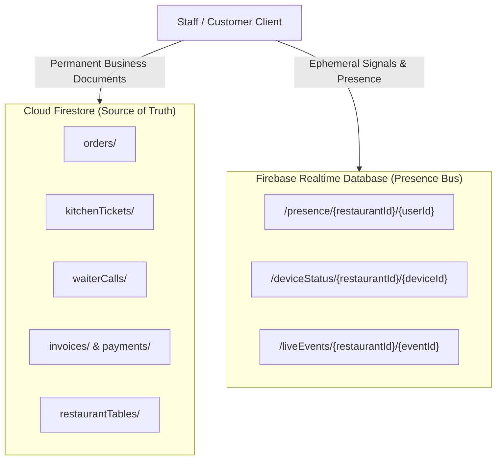

# RESTO OS - Firebase Realtime Architecture & Dual-Engine Strategy

**Document Version:** 1.0.0  
**Target Tier:** Firebase Spark (₹0 / month Free Tier)  
**Engines:** Cloud Firestore (Business Documents) + Firebase Realtime Database (Presence & Signal Bus)  

---

## 1. The Dual-Engine Spark Architecture (Why Both Databases Are Used)

On the Firebase Spark free plan:
- **Cloud Firestore Limits:** 50,000 document reads/day, 20,000 document writes/day.
- **Firebase Realtime Database Limits:** 100 simultaneous connections, 1 GB stored data, 10 GB downloaded bandwidth/month.

### The Quota Risk & Mathematical Solution
If a busy restaurant with 15 staff devices (waiters, kitchen stations, cash counter, managers) sends presence heartbeats and typing signals directly to Firestore every 3 seconds:
$$\text{Writes} = 15 \times 20 \text{ writes/min} \times 60 \text{ min/hr} \times 12 \text{ hrs} = 216{,}000 \text{ writes/day}$$
This would exceed the Spark free limit (20,000 writes/day) by **1,000%** within two hours!

### The RESTO OS Architecture Split
To keep monthly cost **strictly ₹0**, RESTO OS cleanly divides responsibilities between Firestore and Realtime Database:

| Workload Type | Assigned Database | Benefit |
|---|---|---|
| **Authoritative State** (Orders, Items, Invoices, Tables, Menu) | **Cloud Firestore** | Strong consistency, rich document querying, fine-grained collection security rules |
| **Staff Presence & Heartbeats** (`/presence`) | **Realtime Database** | Automatic native `onDisconnect()` hooks, zero Firestore write quota consumption |
| **Instant Operational Signals** (`/liveEvents`) | **Realtime Database** | Sub-100ms lightweight broadcasts for bell chimes and TTS cues |
| **Device Telemetry** (`/deviceStatus`) | **Realtime Database** | Battery level, audio volume, and ping reports without document bloat |

---

## 2. Event Lifecycle & Signal Distribution

### 2.1 New Table Order Flow
1. **Diner Places Order:**
   - [`OrderRepository.createOrder()`](file:///c:/Users/hp/Downloads/resto%20os/src/services/firebase/orderRepository.ts) runs atomic Firestore batch write (`orders`, `orderItems`, `kitchenTickets`, `orderStatusHistory`).
2. **Realtime Signal Emitted:**
   - An ephemeral event payload is pushed to `/liveEvents/{restaurantId}/evt-xxxx` on Realtime Database.
3. **Staff Devices Receive Signal:**
   - Kitchen KDS and Waiter tablet listeners receive the signal in real-time.
   - Waiter device plays chime bell: `audioService.playNewOrderBeep()`.
   - Announcer speaks Hindi/English notification:
     *"Dhyan dijiye! Table number 5 se naya order aaya hai."*
4. **Document Sync:**
   - Real-time Firestore snapshot listener updates the orders list and kitchen ticket grid without page refresh.

### 2.2 Food Ready for Handover Flow
1. Kitchen marks ticket status `READY_FOR_HANDOVER` in Firestore.
2. Signal pushed to Realtime Database `/liveEvents/{restaurantId}` with `eventType: "ORDER_READY"`, `tableNumber: "T-05"`.
3. Assigned waiter device sounds `audioService.playOrderReadyChime()` and announces:
   *"Waiter Rahul, Table number 5 ka order ready hai. Please collect the food."*
4. Waiter clicks "Pick Up" -> "Served".

---

## 3. Duplicate Event Prevention & Reconnect Recovery

To prevent duplicate sound chimes and repeated voice announcements during network reconnection:
1. Every event carries a globally unique `eventId` (`evt-${timestamp}-${random}`).
2. The client maintains an in-memory `processedEventIds` Set.
3. When subscribing with `limitToLast(25)`, newly connected clients verify each event against the Set; if already processed, audio cues are skipped while UI state is reconciled.
4. Old event IDs are automatically purged every 10 minutes to avoid memory leaks.
