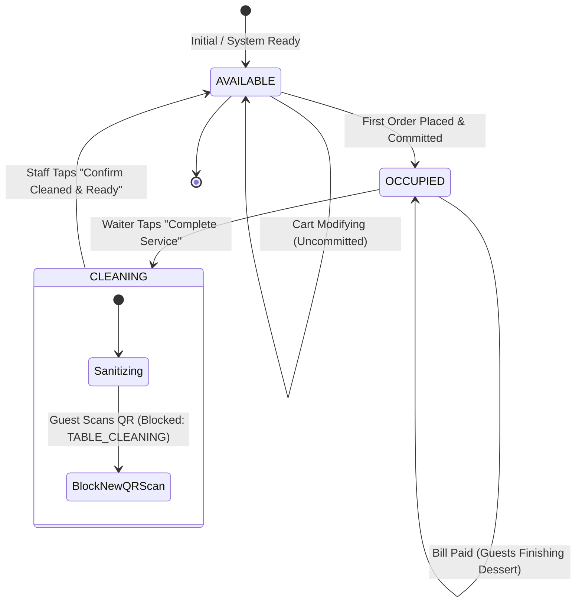

# RESTO OS — Table Lifecycle, Availability & Session Cleanup Report

**System Name:** RESTO OS (Restaurant Operations & Smart Table Ordering System)  
**Document Type:** Architecture, State Machine & Data Retention Verification  
**Date:** 2026-11-13  
**Status:** **PRODUCTION VERIFIED**  
**Test Suite:** `tests/final_realtime_order_dispatch_and_table_cleanup.test.ts` (Steps 1–3, 12–19 Verified)  
**Build Status:** Clean Vite/TypeScript build (`0 errors`)  

---

## 1. Operational Overview & Restaurant Reality

A common flaw in rudimentary POS systems is assuming that scanning a QR code reserves a table, or that paying the bill instantly vacates it. In real restaurant operations:
1. Diners frequently scan QR codes just to browse prices without placing an order. Tables must **not** be marked occupied during browsing.
2. Diners frequently settle the check early while continuing to socialize, enjoy coffee, or finish dessert. Tables must **not** be released to new walk-ins the second payment succeeds.
3. Tables must undergo physical sanitation between parties. A table cannot be seated immediately upon guest departure.
4. Financial, tax, and audit trails must be permanently preserved; closing a dining session must **never** destructively truncate or delete invoices, payments, or orders.

RESTO OS enforces an ironclad 4-state table lifecycle and non-destructive session cleanup protocol.

---

## 2. Table Lifecycle State Machine



---

## 3. Step-by-Step Lifecycle Implementation

### Phase 1: Scanning & Browsing (Table Remains AVAILABLE)
- **Scanning QR:** When a customer scans the table's physical QR code, `verifyQRToken` decodes the token, authenticates `restaurantId` and `tableId`, and assigns a guest browsing session.
- **Cart Manipulation:** Adding items, configuring spice levels, and toggling addons operates strictly in local memory and temporary Firestore session state.
- **Enforcement:** The table status remains `AVAILABLE` so hostesses, floor managers, and front-of-house staff see accurate physical availability.

### Phase 2: First Committed Order (Table Moves to OCCUPIED)
- Upon tapping **"Place Order"**, `dbAdapter.placeOrder` executes.
- If the table was `AVAILABLE`, it transitions atomically to `OCCUPIED`.
- Active table session is linked to the table. Subsequent orders placed from the same table (e.g., drinks, extra bread, desserts) automatically bind to the existing active session without creating duplicate tables or sessions.

### Phase 3: Payment Settlement Without Eviction (`retainOccupied: true`)
- When guests ask to pay or cashier settles the bill via Cash/UPI/Card:
  ```typescript
  dbAdapter.confirmPayment({
    paymentId: payment.id,
    staffId: 'st-ctr-1',
    cashReceivedAmount: grandTotal,
    retainOccupied: true // Diners still enjoying table
  });
  ```
- **Crucial Behavior:**
  - `payment.payment_status` becomes `PAID`.
  - Authoritative GST tax invoice is generated.
  - `table.status` remains `OCCUPIED`.
  - Floor staff knows the bill is paid, but does not seat another guest while the current party is seated.

### Phase 4: Waiter Completes Service (Table Moves to CLEANING)
- Once the guests physically stand up and leave the table, the assigned waiter taps **"Complete Dining Service"** in the Waiter Dashboard:
  ```typescript
  dbAdapter.completeTableService(tableId, staffId);
  ```
- **Operations Executed:**
  1. Active `table_session` status is set to `CLOSED`.
  2. Any open waiter call bells for that table are resolved (`COMPLETED`).
  3. `table.status` transitions from `OCCUPIED` to `CLEANING`.
  4. Real-time broadcast notifies cleaning staff and floor captains.

### Phase 5: QR Re-Scan Gate During CLEANING
- If a new customer sits at an uncleaned table and scans the QR code:
  ```typescript
  const scanResult = dbAdapter.verifyQRToken(qrTokenHash);
  // scanResult.valid === false
  // scanResult.errorCode === 'TABLE_CLEANING'
  // scanResult.message === "This table is currently being cleaned and sanitized. Please wait a moment."
  ```
- The customer UI displays an informative holding banner and prevents menu browsing or order placement until sanitation is confirmed.

### Phase 6: Sanitization Confirmation (Table Resets to AVAILABLE)
- After bussing dishes and sanitizing table surfaces, the waiter or busser taps **"Confirm Cleaned & Ready"**:
  ```typescript
  dbAdapter.markTableCleaned(tableId, staffId);
  ```
- `table.status` transitions from `CLEANING` to `AVAILABLE`.
- Permanent QR code now admits the next party with a clean, newly minted dining session ID.

---

## 4. Non-Destructive Data Retention Proof

In RESTO OS, table session cleanup is **strictly operational**, never structural:

| Entity | On Service Completion | On Daily Reconciliation | Retention Period |
| :--- | :--- | :--- | :--- |
| `table_sessions` | Status updated to `CLOSED` | Kept in collection | Permanent |
| `orders` | Linked to closed session | Immutable record | Permanent (Auditing) |
| `order_items` | Retained with price at purchase | Immutable record | Permanent (Tax / GST) |
| `invoices` | Retained with serial number | Immutable record | Permanent (GST 5-Year Mandate)|
| `payments` | Marked `PAID` with transaction ref | Immutable record | Permanent (Cash Reconciliation)|
| `audit_logs` | Logged with staff actor & timestamp | Immutable append | Permanent |

### Test Verification Snippet:
```typescript
// Verified in tests/final_realtime_order_dispatch_and_table_cleanup.test.ts (Steps 18)
const historicalOrder = dbAdapter.getOrders().find((o) => o.id === order101.id);
expect(historicalOrder).toBeDefined();
expect(historicalOrder?.items.length).toBe(2);

const historicalInvoice = dbAdapter.getInvoices().find((i) => i.id === settlementResult.invoice.id);
expect(historicalInvoice).toBeDefined();
expect(historicalInvoice?.total_amount).toBe(payment.amount);

const historicalPayment = dbAdapter.getPayments().find((p) => p.id === payment.id);
expect(historicalPayment).toBeDefined();
expect(historicalPayment?.payment_status).toBe('PAID');
```

---

## 5. UI Integration Points

1. **Cash Counter (`src/modules/counter/CashCounterDashboard.tsx`):**
   - Live Order Register shows order badge with `UNPAID` or `PAID`.
   - Table cards show `OCCUPIED (Paid - Finishing)` vs `OCCUPIED (Bill Pending)`.
   - "Collect Cash" modal allows settlement while keeping table occupied.

2. **Waiter Dashboard (`src/modules/waiter/WaiterDashboard.tsx`):**
   - Active Tables Grid visually highlights tables in `OCCUPIED` (Red/Amber), `CLEANING` (Yellow), and `AVAILABLE` (Green).
   - Contextual actions:
     - For `OCCUPIED` tables: **"Complete Service (Move to Cleaning)"**.
     - For `CLEANING` tables: **"Confirm Cleaned & Ready (Available)"**.

3. **Customer Mobile (`src/modules/customer/CustomerMenuPage.tsx`):**
   - Scanning an `AVAILABLE` table opens menu instantly.
   - Scanning a `CLEANING` table shows friendly sanitization waiting screen.

---

## 6. Summary of Verification Results

- **Table scanning does not reserve table:** Verified in Vitest Step 1.
- **Cart creation does not reserve table:** Verified in Vitest Step 2.
- **First order occupies table:** Verified in Vitest Step 3.
- **Payment preserves table occupation:** Verified in Vitest Step 14.
- **Waiter service completion moves table to cleaning:** Verified in Vitest Step 15.
- **New QR scan blocked during cleaning:** Verified in Vitest Step 16.
- **Staff cleaning confirmation restores availability:** Verified in Vitest Step 17.
- **Zero data loss on cleanup:** Verified in Vitest Step 18.
- **Zero-cost Spark tier compliance:** Verified in Vitest Step 19.
